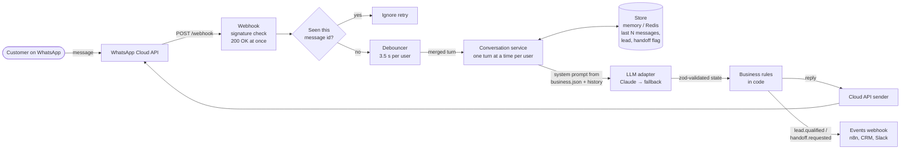

# WhatsApp AI Assistant Template

[](https://github.com/dedaFSdeveloper/whatsapp-ai-assistant-template/actions/workflows/ci.yml)


A production-minded starter for a **WhatsApp AI assistant for small businesses**, built on the official **WhatsApp Cloud API**, **Claude** (Anthropic SDK) and **TypeScript**.

It answers customer questions from a simple JSON file, collects booking details, decides in code when a lead is qualified, and hands the chat to a human when needed. The example business is a fictional dental clinic; swap one JSON file to adapt it to a hair salon, a gym or a law firm.

The design comes from running a real WhatsApp assistant in production (100+ messages a day). This repo is written from scratch and contains no client code or data.

## What it does

- **Webhook for the WhatsApp Cloud API**: verification handshake, `X-Hub-Signature-256` check, and an immediate `200` so Meta does not retry.
- **Dedupe** by message id: Meta retries deliveries, the customer gets one answer.
- **Debounce (3.5 s)**: "hi" + "I need" + "a cleaning" sent as three messages become one turn and one reply.
- **Business knowledge from config**: services, prices, hours and FAQ live in [`config/business.example.json`](config/business.example.json).
- **Structured model output**: the LLM returns a zod-validated object (`reply`, `intent`, extracted lead data, `wantsHuman`), not free text.
- **Business rules in code, not in the prompt**: "qualified lead", "hand off to a human" and "the bot is stuck" are decided by [`src/core/rules.ts`](src/core/rules.ts). They are unit-tested and do not change when you change models.
- **Human handoff** per conversation: once active, the bot stays silent, keeps storing messages, and notifies your team. An admin endpoint gives the chat back to the bot.
- **LLM adapters**: Claude by default, with any OpenAI-compatible endpoint (Gemini, OpenAI, Groq, a local model) as automatic fallback.
- **Bounded memory**: only the last N messages are sent to the model. In-memory store for development, Redis for production.
- **Events** (`lead.qualified`, `handoff.requested`) posted to any URL: an n8n workflow, a CRM, a Slack relay.
- `/health`, Docker, docker-compose with Redis, Vitest tests and GitHub Actions CI.

## Architecture



```
src/
  index.ts              wiring and graceful shutdown
  server.ts             Express routes: /webhook, /health, /admin
  config.ts             environment validation (zod)
  business/business.ts  business config schema and loader
  core/
    dedupe.ts           message-id deduplication with TTL
    debouncer.ts        per-user message grouping
    rules.ts            qualified lead + handoff decisions
    conversation.ts     one customer turn, end to end
    events.ts           outgoing event webhook
  llm/
    types.ts            adapter interface + response schema
    prompt.ts           system prompt and history preparation
    anthropic.ts        Claude adapter (structured outputs)
    openai-compatible.ts fallback adapter (JSON mode)
    fallback.ts         provider chain
  store/                in-memory and Redis conversation stores
  whatsapp/             webhook parsing, signature check, sender
tests/                  Vitest suites
```

## Quick start

Requirements: Node.js 22+ (or Docker), an Anthropic API key and/or an OpenAI-compatible key (Gemini works).

```bash
git clone https://github.com/dedaFSdeveloper/whatsapp-ai-assistant-template.git
cd whatsapp-ai-assistant-template
npm install
cp .env.example .env      # then fill in at least WHATSAPP_VERIFY_TOKEN and one LLM key
npm run dev
```

Without WhatsApp credentials the app runs in **dry-run mode**: replies are logged instead of sent. You can try it with a fake webhook call:

```bash
curl -X POST http://localhost:3000/webhook -H "content-type: application/json" -d '{
  "object": "whatsapp_business_account",
  "entry": [{ "changes": [{ "field": "messages", "value": {
    "contacts": [{ "wa_id": "5491100000000", "profile": { "name": "Test" } }],
    "messages": [{ "id": "wamid.TEST1", "from": "5491100000000", "timestamp": "1764000000",
                   "type": "text", "text": { "body": "Hi! How much is a cleaning?" } }]
  }}]}]
}'
```

After 3.5 seconds the reply shows up in the logs.

### Connect a real WhatsApp number

1. Create an app in [Meta for Developers](https://developers.facebook.com/) and add the **WhatsApp** product.
2. Copy the **phone number id**, a **permanent access token** (system user) and the **app secret** into `.env`.
3. Expose your server over HTTPS (a deployed server, or a tunnel such as `cloudflared` or `ngrok` for testing).
4. In the WhatsApp configuration, set the callback URL to `https://your-domain/webhook` and the verify token to `WHATSAPP_VERIFY_TOKEN`. Subscribe to the `messages` field.

### Docker

```bash
cp .env.example .env
docker compose up --build
```

This starts the assistant and Redis; conversations survive restarts.

### Scripts

| Command | What it does |
| --- | --- |
| `npm run dev` | Start with reload |
| `npm test` | Run the Vitest suites |
| `npm run lint` / `npm run typecheck` | ESLint / `tsc --noEmit` |
| `npm run build` && `npm start` | Compile to `dist/` and run |

## Adapting it to another business

1. Copy `config/business.example.json` to `config/business.json` (git-ignored) and set `BUSINESS_CONFIG_PATH=config/business.json`.
2. Replace the name, tone, contact data, **services** (each with a stable `id`) and **FAQ**.
3. Tune the **rules**:
   - `qualifiedLead`: which data makes a lead worth a call (name, service, preferred time).
   - `handoffKeywords`: words that always send the chat to a human, matched in code (accent and case insensitive).
   - `handoffIntents`: intents that need a person (`emergency`, `complaint`...).
   - `maxConsecutiveUnknown`: how many "I don't know" answers in a row before handing off.
4. Point `EVENTS_WEBHOOK_URL` at whatever should react to new leads and handoffs.
5. If you need new intents or fields, extend `AssistantTurnSchema` in [`src/llm/types.ts`](src/llm/types.ts) and the rules in [`src/core/rules.ts`](src/core/rules.ts); add a test for each new rule.

### Admin endpoints

Enabled only when `ADMIN_TOKEN` is set (send it as `Authorization: Bearer <token>`):

- `GET /admin/handoffs` lists conversations waiting for a human.
- `POST /admin/conversations/:waId/release` gives a conversation back to the bot.

## Design decisions

- **The model describes, code decides.** The LLM reports intent and extracted data; whether that means "qualified lead" or "call a human" is plain TypeScript. Prompts drift between model versions, `if` statements do not.
- **Validate everything that crosses a boundary.** Env vars, the business file, webhook payloads and model output all go through zod.
- **Ack first, think later.** The webhook returns `200` before any LLM call, so slow models never trigger Meta retries.
- **One turn at a time per customer.** A per-user queue prevents two answers racing each other.
- **Fail towards a human.** If every model fails, the customer gets a polite message and the team gets a handoff event.

## Limitations

- Dedupe and debounce live in process memory: run **one instance**, or move dedupe to Redis (`SET NX EX`) and route each user to the same instance before scaling out.
- Text only. Audio, images and documents are acknowledged but not processed (no transcription or vision yet).
- No real booking: the bot collects the data and emits `lead.qualified`; connecting a calendar is up to you.
- Replies are only possible inside WhatsApp's 24-hour customer service window. Outbound templates are not implemented.
- The handoff only silences the bot. Your team answers from WhatsApp Business tools or an inbox such as Chatwoot, then calls the release endpoint.
- No dashboard, analytics, rate limiting or multi-tenant support.

## Related projects

- [whatsapp-lead-qualifier](https://github.com/dedaFSdeveloper/whatsapp-lead-qualifier): lead scoring for WhatsApp conversations with Gemini and zod.
- [github-mcp-server](https://github.com/dedaFSdeveloper/github-mcp-server): an MCP server for GitHub.

## License

[MIT](LICENSE)

---

## En español

Plantilla open source para armar un **asistente de WhatsApp con IA para pymes**: responde preguntas con la info del negocio (un JSON), junta los datos para un turno, decide **en código** cuándo un lead está calificado y pasa la conversación a una persona cuando hace falta.

- Usa la **API oficial de WhatsApp Cloud**, **Claude** como modelo principal y cualquier API compatible con OpenAI (por ejemplo Gemini) como respaldo.
- Responde 200 al instante, descarta mensajes duplicados y junta los mensajes seguidos (3,5 s) en una sola respuesta.
- Para usarlo en otro rubro, alcanza con editar `config/business.example.json` (servicios, precios, horarios, preguntas frecuentes y reglas).
- Arrancá con `npm install`, `cp .env.example .env` y `npm run dev`. Sin credenciales de WhatsApp funciona en modo prueba y muestra las respuestas en los logs.

Hecho por [Ezequiel Molinari](https://github.com/dedaFSdeveloper). Si te sirve, dejale una estrella.
